# Wayward: прогон руками (2026-11-12, ночь)

Сборка `index.html` v2026-11-09 с тремя модами Алексея. Играл сам, в браузере, плюс читы и консоль. Код и тексты не копировал: ниже только как устроено, своими словами.

**Как запускал.** Вкладка `file://` расширению недоступна, поэтому поднял на ПК `python -m http.server` на `127.0.0.1:8195` (папка Wayward, только чтение) и играл с этого адреса. У адреса своё пустое хранилище: твои сейвы физически лежат в другом месте, я их не видел и тронуть не мог. Твой "нулевой" слот тоже остался как был. Картинок на этом адресе нет (паки привязаны к `file://`), так что место под картинку на скриншотах пустое - на раскладку это не влияет.

**Сколько сыграно.** Героиня Mara (жена, всё "на Судьбу"). Дни 1-7 подробно (два старта выкинул из-за своих же кривых скриптов), дальше автопрогон до третьей недели - итог в конце файла. На 3-й день читами увёл её в "раскованную" (раскрепощённость, уверенность вверх, верность вниз, вкусы в плюс), на 5-й купил все постройки. Состояния (злая, счастливая, уставшая, пьяная, без доверия, раздражена) выставлял через консоль и на каждом жал одни и те же действия.

Скриншоты: `docs/wayward-shots/`.

---

## 0. Читы

| Клавиша | Что это |
|---|---|
| **F9** | Панель "Читы" справа, около 80 ползунков с числом и галкой у каждого. Блоки: деньги и таверна (золото, долг, аренда, три запаса, готовая еда, чистота, три репутации), вы (силы, настроение, возбуждение, усталость, магия), ваши навыки и 12 качеств, она: кнопки "свежая / трезвая / убрать плохие чувства / раздражение 0", состояние (6), качества (12) + "кем себя считает" (2), навыки, вкусы -2..+2 (11), блоки модов, 19 скрытых черт с двумя галками (есть / заметил), 28 нарядов. Backspace - отменить. 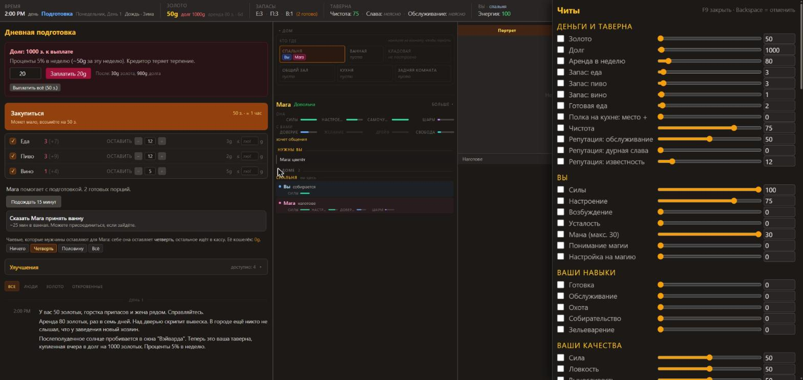 |
| **F4** | Настройки мода "Её власть" (около 50 строк) + четыре числа этой игры. 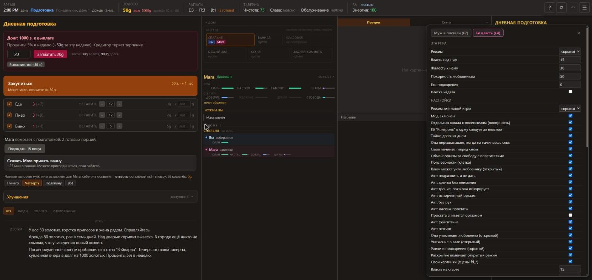 |
| **F7** | Настройки мода "Муж в постели". |
| **F6** | Настройки мода "Размер имеет значение". |
| **Esc** | Пауза: продолжить, сохранить, загрузить, настройки, энциклопедия, в меню. 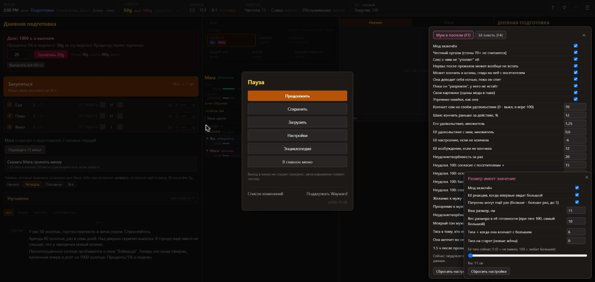 |
| Консоль | `wayward.get / set / edit` - правка любого числа состояния. |

То есть F4/F6/F7 - не читы, а настройки твоих модов; чит-панель одна, F9.

**У нас:** чит-панель есть (`mods/cheats`), открывается кнопкой "отладка" и лежит под картой комнат. **Меняем:** F9, панель справа поверх экрана, ползунки по блокам, кнопки-сбросы ("свежая", "трезвая", "раздражение 0").

---

## 1. Экран целиком

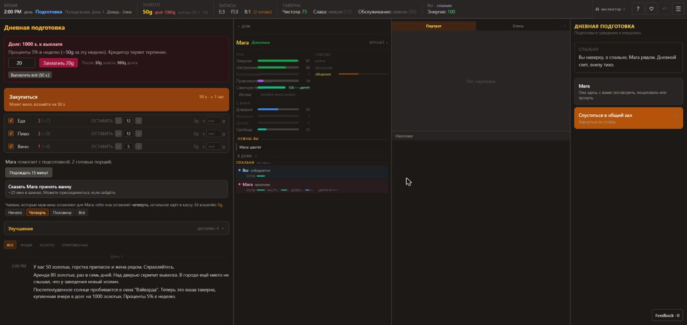

### У них

**Шапка, одна строка:** время + время суток словом + фаза цветом + день недели, день, погода, сезон | золото, долг, аренда и через сколько дней | запасы "Е:3 П:3 В:1 (2 готово)" | чистота, слава, обслуживание (словом; в режиме разработчика рядом число) | где вы и ваша энергия | справа: "инспектор" (только в режиме разработчика), "?" (энциклопедия), донат, откат, меню. На узком окне шапка листается вбок.

**Четыре колонки**, порядок и ширина настраиваются мышью (тянуть колонку и границу), есть "сбросить":

1. **История** (34%). В подготовке сверху задачи фазы: долг (поле суммы, "после: столько-то"), закупка одной большой кнопкой с ценой и временем + три строки запасов (галка, "оставить N", цена, потолок цены), "подождать 15 минут", "сказать ей принять ванну", доля её чаевых, сворачиваемые улучшения. Ниже лог с фильтрами (все / люди / золото / откровенные). **В смену задачи исчезают, остаётся только лог.**
2. **Дом** (23%). Сворачиваемая сетка комнат "кто где" (клик = перейти). Её карточка: имя, состояние одним словом ("довольна", "несчастна", "счастлива в хлам"), чипы ("навеселе", "2 заметили" + сами открытые черты), кнопка "больше / меньше". Развёрнуто: полоски "она" (энергия, настроение, возбуждение, привлекательность, хмель, самочувствие словом, интим за сегодня), "с вами" (доверие, желание, дрейф, свобода), справа столбец "чувство" (каждое чувство полоской и причиной под ней), "желания" (чего ей сейчас хочется), "память" (что с ней осталось со вчера). Ниже "нужны вы" и список "в доме" по комнатам: у каждого чем занят и мини-полоски; у гостя - что пьёт, сколько наел, кто им занимается. Наведение на гостя - карточка с терпением. Внизу "сегодня: обслужено N, +Ng".
3. **Фокус** (26%). Вкладки "портрет / статы" (статы = полный лист персонажа с шестью вкладками), картинка, под ней подпись, блок инспектора, карточка исхода, её мысли.
4. **Действия** (17%). Заголовок фазы и подсказка под ним, дальше карточки.

**Что появляется только в какой-то фазе:**
- подготовка: задачи в левой колонке; справа "открыть пораньше", "выйти...", "по городу";
- смена: слева только лог; справа "ждать" с четырьмя длинами, "торговцы", "конец смены"; внизу колонки "дом" счётчик дня;
- закрытие: то же, но вместо "закрыть двери" - "подняться наверх";
- спальня: справа только её карточка и "лечь спать";
- сон: карточка с полоской "до пробуждения" и "спать до утра";
- сцена: вся правая колонка становится сценой (полоски "вы / она", текст хода, действия).

### У нас

Три колонки: журнал | сцена + карта комнат + (в отладке) читы | всё остальное одной лентой: ждать, постель, ответы ей, меню "к ней", прочие действия группами, кнопка фазы, шесть вкладок с её состоянием. Шапка есть (время, фаза, день недели, погода, деньги, долг, склад).

### Что меняем

- Четыре колонки по их логике: история (задачи фазы + лог) | дом (кто где, её карточка, "нужны вы", кто в доме) | фокус (картинка, подпись, инспектор, исход, её мысли; вкладки с подробностями под картинкой) | действия.
- Её состояние одним словом + чипы в заголовке карточки; полоски в два столбца ("она" / "с вами"), чувства с причиной.
- Вкладки "она / вы / гости / почему / телефон / счёт" уезжают из колонки действий под картинку: в колонке действий остаются только действия.
- В смену левая колонка - только лог.
- Мусор долой: счётчики в карточке "ждать", дублирующие шапку; строка "scene/seed/turn" - только в отладке; читы - в выезжающую панель.

---

## 2. Правое меню

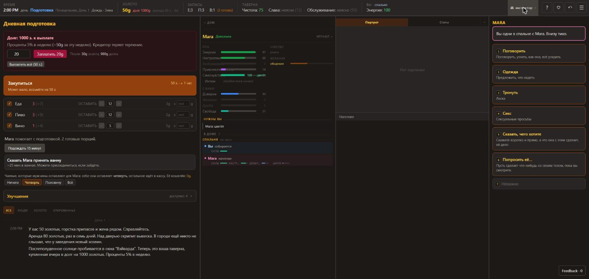 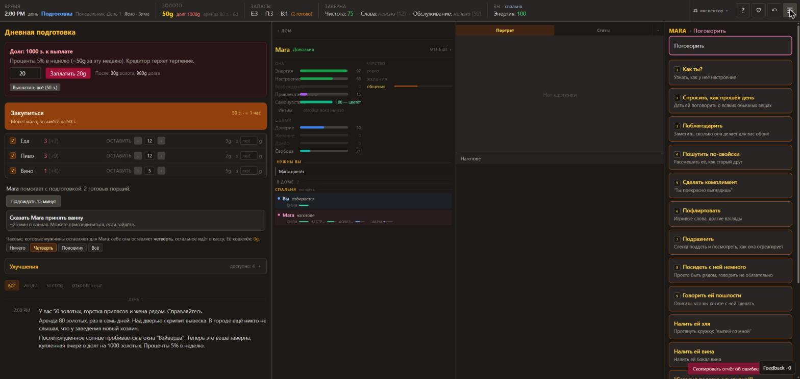

### У них

- **В покое** колонка - список карточек места: у каждой буква-хоткей в квадратике (F кухня, C уборка, W ждать, T работать, G выйти), заголовок, строка пояснения и длительность справа ("25m"). "Ждать" - карточка с четырьмя кнопками (1m, 5m, 15m, "до посетителя" на Enter). Разделы с заголовками-капсом: "работа", "по городу · до 9pm", "конец смены". Кнопка "работать в таверне" сама пишет, что именно он сейчас сделает ("посторожить 5 мин" / "убрать таверну 33 мин").
- **Клик по её карточке** разворачивает меню на всю колонку. Сверху **крошки**: `MARA` -> `MARA › Поговорить` -> `MARA › поведение` и т.д. Под крошками рамка-контекст: где вы и кто рядом, либо название подменю, либо вопрос ("Трогать её. Какое?").
- **Пункты - карточки:** цифра-хоткей, заголовок, под ним пояснение или сама реплика в кавычках. Первые девять с цифрами, остальные без. В конце всегда "назад" (на уровень вверх) и "неважно" (закрыть меню совсем).
- **Корень (7):** поговорить, одежда, тронуть, секс, сказать чего хотите, попросить её, неважно. После её поступка появляется временный пункт "насчёт её одежды..." - три реплики-оценки с пометкой тона.
- **Поговорить (14):** как ты, как день, поблагодарить, пошутить, комплимент, флирт, подразнить, посидеть, пошлости, налить эля, налить вина, "полегче с выпивкой", "как прошёл вечер?", "о нас" (ещё пять вопросов).
- **Одежда (4):** приказы на вечер, список сжимается по мере выполненного.
- **Тронуть (10), секс (7), попросить её (2)** - у "попросить" сверху переключатель манеры: спросить / властно / украдкой.
- **Сказать, чего хотите (9):** восемь установок, у каждой реплика и строка "что это значит, решать ей"; девятая - "насчёт мужчин": группа (трогать её / её руки и рот / секс / когда её видят, с примерами в подписи) -> список актов -> "давай" / "не надо".
- **Пометки:** после слов пункт получает хвост: `(вы сказали "давай")`, `[сказано сегодня]`, по ходу дней - `[сказано в день N]`.
- **После действия меню остаётся в том же подменю** (можно жать дальше). После её отказа - закрывается.
- **Ситуация** (она или гость чего-то ждут) замещает всё меню: заголовок "СИТУАЦИЯ" / "⚠ MARA СМОТРИТ НА ВАС" / "⚠ МОМЕНТ", текст, 2-5 ответов-карточек с цифрами, у каждого в подписи прямо написано последствие.

### У нас

Меню "к ней" есть: кнопка -> семь разделов кнопками со счётчиком в скобках -> плоский список кнопок без пояснений. Крошка - одна строка "назад · имя · раздел". Хоткеи только у ожидания и у восьми "прямых" кнопок. Пометок "сказано" нет. Ответы ей - строка чипов "она подошла".

### Что меняем

- Колонка действий - единое меню с крошками: корень фазы -> "она" -> раздел. Над пунктами рамка-контекст.
- Пункты карточками: хоткей 1-9, заголовок, подпись (берём из текстов, где есть; где нет - без подписи).
- "Назад" и "неважно" внизу, Esc = назад.
- Пометки "сказано сегодня" у установок и "ты сказал: можно / нельзя" у разрешений - данные есть (`wishes`, `perm`).
- Ситуация (её вопрос, сделка, "застал") занимает меню целиком, с текстом вопроса сверху.
- После действия меню не схлопывается.

---

## 3. Инспектор и блок отладки под картинкой

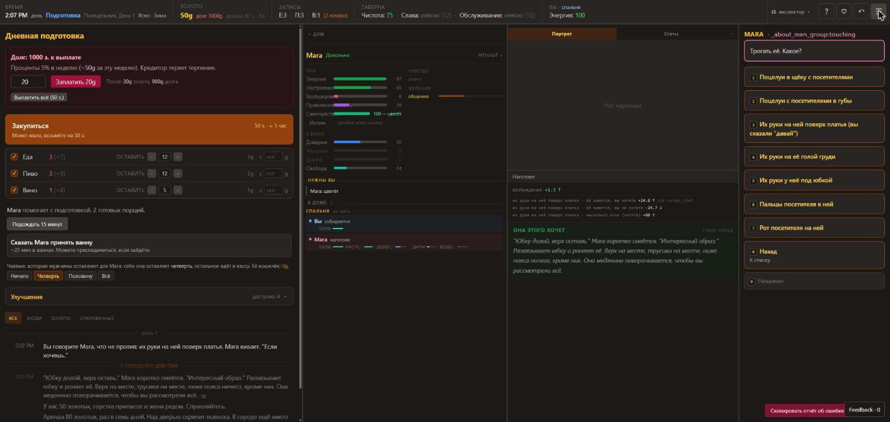 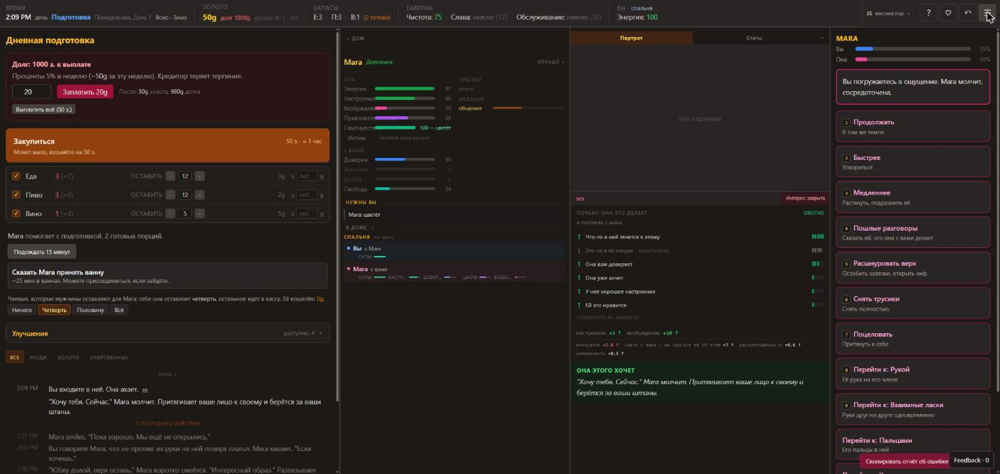 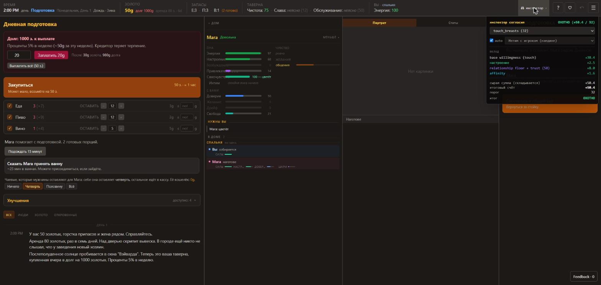

### У них

Включается в настройках ("режим разработчика"). Даёт четыре вещи.

**А. Строки дельт под картинкой - после каждого действия, включая "ждать" и ночь.**
- Первая строка, крупно, цветом и стрелкой: главные числа - настроение, возбуждение, силы, доверие, желание, обида, хмель.
- Ниже мелко, серым, моноширинным: всё остальное, строка = "о чём · что именно +число ↑ via источник":
  - убеждения по актам: "<акт> · ей кажется, вы хотите +24.8 via verbal_chat", "<акт> · ей кажется, вы не хотите -24.7", "<акт> · насколько ясно (хотите) +80";
  - "<акт> · вы просите её об этом +7" - счётчик твоих просьб по акту;
  - "<гость> · вы его ей одобряете +2", "<гость> · вы не хотите его рядом с ней +3.6";
  - "<гость> · симпатия +5, романтика +3, её привязанность +2.5";
  - раздражение, раскрепощённость и уверенность (десятые доли), "склонность: грудь +0.02";
  - "почувствовала <чувство> 60 · <причина>", "отмечено (<чувство>) <что запомнила>".
- Источники (via), какие видел: сказал словами, разрешил в моменте, подбодрил в моменте, остановил в моменте, запретил словами, прошёл мимо и промолчал.
- Утром тем же блоком приходит ночь: силы +59, хмель -10, **все убеждения понемногу откатываются** ("вы хотите -2", "ясность -1.5", "одобряете гостя -2"), характер сдвигается к самоощущению.

**Б. "Почему она это делает" - при старте сцены.** Уровень словом (охотно / колеблется), контекст ("в постели с вами"), причины простыми словами со стрелкой и полоской силы: "что-то в ней тянется к этому", "она вам доверяет", "она уже хочет", "хорошее настроение", "ей это нравится", "она выпила", "это не в её натуре - преодолено" (минус, зачёркнут). Внизу "ГОТОВНОСТЬ 64 · НУЖНО 42".

**В. "Инспектор согласия" в шапке - калькулятор "что если".** Выбираешь любой из 33 актов (у каждого виден порог: поцелуй 8 ... секс 42 ... на людях 78) и контекст (с мужем наедине / просьба гостя / платное предложение / вызов / её инициатива) - получаешь строки вклада, сумму, порог и вердикт. Не дожидаясь, пока это случится в игре.

**Г. Мелочи:** числа в скобках у репутаций в шапке; в листе персонажа "показать Raw JSON".

### У нас

Есть строки формулы согласия на последний её ответ (`WhyLine` под сценой, вкладка "почему") и причины у четырёх быстрых чисел (`h.why`, видны в прозрачном режиме во вкладке "она"). **Нет** сводки "что изменилось за это действие": чтобы понять, сдвинулось ли что-то, надо помнить старое число. Нет источника у убеждений ("что она думает, ты разрешаешь" просто меняется). Нет калькулятора.

### Что меняем (это пункт 1 части 2)

- После каждого действия под сценой блок: что нажал -> главные дельты строкой -> мелкие строки "что · на сколько · откуда". Собирается разницей состояния до и после плюс причины из событий (`heroine:changed` уже несёт причину). Туда же: убеждения по актам (`expect`), разрешения, доверие/желание/обида, чувства, натёртость, гости (симпатия, интерес, как далеко зашёл), деньги, склад, чистота, слава, слухи.
- Пустое действие честно пишет "ничего не изменилось".
- Ночь приходит утром одним блоком.
- Калькулятор "что если" по акту и партнёру - вторым шагом (движок это уже умеет: `engine.evaluate`).

---

## 4. Действия по фазам

Время идёт минутами, сутки целые. Подготовка примерно с 7-8 утра до 17:00, смена с 17:00 (можно открыть раньше) до "закрыть двери" (сам, хоть за полночь), закрытие, спальня, сон.

| Действие | Подготовка | Смена | Закрытие | Спальня / ночь | Утро | Что требует | Что меняет |
|---|---|---|---|---|---|---|---|
| Заплатить долг (сумма / всё) | да | - | - | - | да | золото | долг |
| Закупиться (вылазка на рынок, ~60 мин) | да | - | - | - | да | золото; можно отметить, что брать и до скольки | запасы; пока тебя нет, она дома одна и живёт своей жизнью |
| Подождать 15 мин (слева) | да | - | - | - | да | - | время |
| Сказать ей принять ванну | да | - | - | - | да | она рядом, слушается по "весу слова" | ~25 мин, можно зайти к ней |
| Доля её чаевых (0 / четверть / половина / всё) | да | - | - | - | да | - | её кошелёк, её "деньги" как влечение |
| Улучшения | да | - | - | - | да | золото; заднюю комнату ещё 120 мин руками | уровень таверны (потолок репутации), содержание в неделю, новые комнаты |
| Кухня: готовить (15 мин) | да | да | да | - | да | сырая еда | готовые порции, навык |
| Кухня: варить | да | да | да | - | да | травы | зелья, мази |
| Убрать таверну (~25-40 мин) | да | да | да | - | да | - | чистота; время идёт, события прерывают |
| Работать в таверне 5 мин / 1 ч | да (до открытия не с кем) | да | да | - | - | - | сам выбирает дело: сторожить, убрать |
| Открыть пораньше | да | - | - | - | да | - | смена начинается сейчас |
| Выйти: травы (2 вида), охота (2 вида), подработка, портной, её родня | да (у каждого свой крайний час) | да (она остаётся одна) | - | - | да | силы; ноги целы | добыча, деньги, наряды; "способная на измену видит шанс" |
| Повесить объявление / зазывать | до 21:00 | до 21:00 | - | - | да | 5 з. / 30 мин | гости сегодня и на несколько вечеров |
| Ждать 1 / 5 / 15 мин / до посетителя | на кухне и в комнатах | да | да | ночью 1/5/15 | - | - | время; "до посетителя" прерывается событием |
| Торговать с гостем | - | да, если у гостя товар | да | - | - | золото | травы, страницы |
| Перейти в комнату (клик по сетке) | да | да | да | да | да | 1 мин | где ты; что видишь |
| Меню "она" (поговорить, одежда, тронуть, секс, чего хочу, попросить) | да, если в одной комнате | да ("отвести в сторону") | да | да ("теперь вы наедине") | да | рядом; секс и касания упираются в раздражение, усталость, "хватит" тела | см. п. 6 |
| "Как прошёл вечер?", "о нас" | есть всегда, осмысленно вечером | да | да | да | да | - | её отчёт; честность видна ("похоже, искренне") |
| Ответ на ситуацию | да (она просит денег на рынок) | да | да | да (она будит) | да | - | убеждения, доверие, обида, отношение к гостю |
| Закрыть двери | - | да | - | - | - | - | новых не будет, оставшиеся допивают |
| Подняться наверх (итог дня) | - | - | да (или после полуночи) | - | - | - | итог дня в лог, фаза "спальня" |
| Лечь спать -> спать до утра | - | - | - | да | - | - | сон прерывается, если "вы понадобитесь" |
| Отреагировать на её вид ("насчёт её одежды", "она в беспорядке") | да | да | да | да | да | она что-то сделала сама или по приказу | три тона: унизить / похвалить / нежно |
| Магия (чары, гримуар) | да | ? | ? | ? | да | найти книгу в задней комнате | не разбирал |

**У нас:** фазы те же (подготовка, смена, ночь по часам, утро). Закупка мгновенная и одним числом; "выйти" - город (рынок, магазины, качалка, площадь); улучшений три; готовки нет; уборка есть; ванная есть без действий; ответ ей - чипами.
**Что меняем:** таблицу действий у нас показывать так же - карточками с длительностью и пояснением; остальное - в списке "чего нет" внизу.

---

## 5. Сцены

### С мужем

Старт - из меню "секс" или она сама (будит утром, целует между стойкой и кухней, тянет на кровать после поцелуя). Перед началом - блок "почему она это делает" (п. 3Б). Дальше правая колонка - это сцена:

- две полоски "вы N% / она N%";
- рамка с текстом хода и временем "(1 мин)";
- действия: продолжать, быстрее, медленнее, пошлые разговоры, одежда по шагам (расшнуровать верх, снять юбку, снять трусики), поцеловать, "перейти к: ..." (рукой, взаимно, пальцами, ртом, она сверху, грубо), прекратить и вернуться к работе;
- один ход = минута, полоски растут; текст хода зависит от её состояния ("молчит, сосредоточена" / "глаза полуприкрыты").

Ведёт муж, кроме случая "позволить - она ведёт". Финал - сам, по полоске. После финала - **меню "после"** из семи вариантов: быть нежным, похвалить, взять всё в свои руки, унизить, дать ей вести, "ещё разок?", отстраниться. "Нежным" дало: настроение, доверие, вкус к романтике, чувство "нежность" с причиной и запись в память "нежный момент" - которая потом два дня всплывает в её мыслях и висит в карточке ("память · прошлой ночью").

### С гостем в зале

Сцены как отдельного экрана нет: это **лестница мелких шагов в логе**, по минутам, пока ты занят своим. Разговор -> комплимент -> поймал руку -> она подсела -> рука на пояснице -> на бедре -> под одежду -> дальше. У гостя есть своя внутренняя стадия ("перестал делать вид, что это просто разговор", "взгляд изменился") и характер, который слышен в каждой строке ("немного неуверенно", "скажи остановиться, и я остановлюсь"). Ведёт гость, она пускает или нет.

**Перед каждым большим шагом она останавливается и смотрит на тебя** - ситуация "позволить / остановить". "Позволить" = "для неё это твоё да этому с ним" (растёт убеждение по акту и твоё одобрение этого гостя). "Остановить" = она говорит ему "только не это" (растёт "не хочешь" по акту и "не хочешь его рядом").

Чем кончается: гость допил и ушёл (оставил чаевые по итогам, после близости - в разы больше), или она его осадила, или он принял отказ. **После:** строка "она знает, что ты видел"; позже сама подходит: "я правильно поступила с ним?"; ещё позже может прийти с признанием-развилкой ("он был не первым на этой неделе... как ты хочешь, чтобы я с этим поступала": говори им нет / решай сама / может, и стоит).

### Наедине с гостем (комната наверху)

Постоялец с ключом зовёт её наверх - ситуация из четырёх: иди / иди, но до предела (и второй вопрос "где граница?" из четырёх границ) / пусть решает она / отказать ему (ей обидно: доверие вниз, обида вверх). Дверь закрывается, и ты получаешь только уведомление о стадии: "она наверху с ним, дошло уже до того-то, а вас там нет". Что именно было - частично в логе (в режиме разработчика всё). Наверху она сама держит свою границу ("не это, не дави") и отказывает от усталости.

### С несколькими

Видел только завязку: два гостя зовут её одновременно, зал заметил - "⚠ момент" из пяти вариантов (одному ждать очереди, другому, пусть сама, отправить обоих, "играй с обоими" - помечено как рискованное). Второй гость ревнует к первому ("не держи её только для себя"). Групповую сцену за 7 дней не получил.

### Когда кто-то смотрит

В готовности есть отдельный акт "на людях" с самым высоким порогом; в "да/нет" записано "кто смотрит"; при лишних глазах она прикрывается, если ей это не нравится. Родня и друзья заходят "на кружку" - при них она ведёт себя прилично. Твоё присутствие решает всё: обида растёт только за то, что ты позволил у себя на глазах.

### У нас

Сцена с мужем по ходам есть (темп, слова, смена акта, финалы, "после"), она ведёт и выбирает финал. С гостем: предложения актов по лестнице, сцена по минутам, зеваки, второй и третий гость, "застал" с выбором, "присоединиться". Она спрашивает разрешения (сделано), позиция по гостю (сделано), разговор о случившемся (сделано).

### Что меняем

- **Шаги с гостем мельче и в логе.** У нас гость сразу предлагает акт; у них до первого акта пять-шесть строк разговора и касаний, по которым видно, куда идёт. Мелкие события у столика у нас есть (24) - их надо связать в цепочку у одного гостя и показывать его стадию.
- **"Смотрит на тебя" перед шагом** - у нас она спрашивает разрешения словами; добавить немой вариант "позволить / остановить", когда ты в зале и видишь.
- **Уведомление "она там-то с тем-то, дошло до..."**, когда ты не рядом - одной строкой-прерыванием.
- **"После" у гостя:** "она знает, что ты видел" и её вопрос "я правильно поступила?" - связать с имеющимся разговором о случившемся.
- **Блок "почему она это делает"** словами со стрелками - поверх наших строк формулы.

---

## 6. Её реакции и реплики

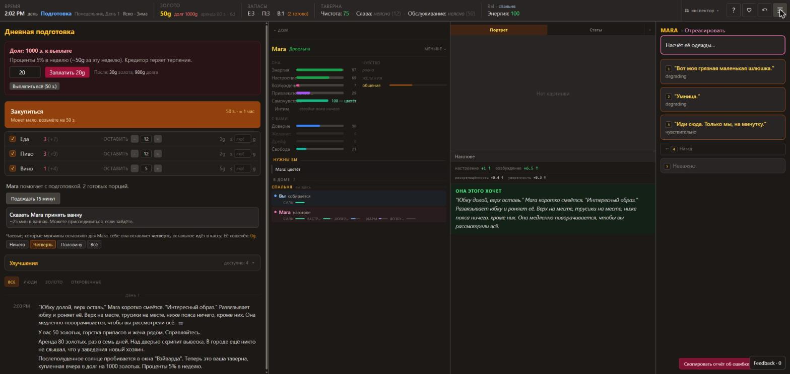

### У них

**Карточка исхода** под картинкой: цветной заголовок-вердикт, справа давность ("7 мин. назад"), курсивом что произошло. Вердиктов пять: "она этого хочет" (зелёный), "она согласна", "она не уверена...", "она отстраняется" (красный), "она расстроена". Карточка держится до следующего значимого действия.

**Одно действие в разных состояниях** (числа ставил консолью, после каждого нажатия откат):

| Действие | Обычная | Счастлива, заведена | Устала (силы 5) | Пьяная | Доверие 4 | Настроение 10 | Раздражение 50 | Раздражение 80 |
|---|---|---|---|---|---|---|---|---|
| "Как ты?" | улыбается, "пока хорошо, ещё не открылись" | то же | обмякает на руке, просит подержать | виснет, хихикает, "ты красивый" | - | вздыхает, "уже устала" (вердикт "не уверена") | - | вздыхает |
| Поцеловать | да, тянет на кровать | да | да | да | да (+доверие) | да | мягко снимает руку: "не сейчас, на сегодня хватило" | резко: "сегодня больше никаких рук, я серьёзно", спиной |
| Рука под юбку | хочет, держит руку | хочет | "стой, я не готова", дрожит | хочет | хочет | хочет | тот же мягкий отказ | тот же резкий |
| Секс | молча притягивает (хочет) | то же, причин больше | "я выжата, сегодня ничего не осталось", не извиняется | хочет, причина "выпила" | "смелый сегодня... ладно, покажи" (не уверена) | то же "ладно, покажи" | мягкий отказ | резкий |
| Минет (вкуса и опыта нет) | смеётся от неожиданности: "я никогда... ты серьёзно?" | тёплый отказ: "нет, милый, не хочется" | как обычная, плюс доверие вниз | соглашается охотно | как обычная | как обычная | мягкий отказ | резкий |

Что из этого следует:

1. **У отказа есть причина, и у каждой причины свой текст:** нет опыта / не хочется (тепло) / устала / не готова / "на сегодня хватило" / "никаких рук". Причина берётся из того, какая строка формулы перевесила.
2. **У согласия два голоса:** охотно и "ладно, покажи". Реплика мужа при этом тоже меняется.
3. **Раздражение - общий шлагбаум** для всех касаний: 50 - мягкий, 80 - жёсткий, один текст на всё.
4. **Пьяная речь** - многоточия во всех её репликах, включая отказы.
5. **Контекст фазы** попадает в ответ ("мы ещё не открылись").
6. Просьба оставляет след, даже принятая: раздражение +2.8 (отвергнутая +11.3) и "вы просите её об этом +7".
7. **С гостем то же:** на комплимент на 2-й день "краснеет и мямлит" (уверенность вниз), на 4-й, уже смелая, - отшучивается и идёт дальше (настроение вверх). Танец для стола: скованный, руки у боков - или находит ритм. На хамство отвечает сама, зал смеётся.

**Вне действий она говорит сама** - каждые 10-30 тихих минут строчка: наливает две кружки, садится на стойку, стоит ближе, чем нужно, ловит взгляд. По ним видно настроение и что вчерашнее в ней сидит. Повторы есть (одна и та же строка про кружку три раза за вечер) - у них это тоже не вылизано.

**Её мысли** - сворачиваемый блок под карточкой исхода, с давностью: один абзац о том, что она сейчас про себя понимает (про мужа, про вчерашнее, про деньги). Утром - отдельная строка "какой она кажется" (напевает / тише обычного / двигается осторожно).

**Ожидания** (вкладка листа): "чего, по её мнению, вы не хотите" - фразами со степенью ясности ("смутно чувствует, граница размыта"), и "куда её может уносить".

### У нас

Реплики на разговор и касания есть, ответы на претензии, мысли в логе (прозрачный режим), ожидания по актам. Отказ один на акт, не зависит от причины. Состояние в реплику почти не попадает (кроме настроения в части разговоров). Карточки исхода нет: её ответ - строка лога и строка "почему".

### Что меняем (пункт 3 части 2)

- **Карточка исхода** под сценой: вердикт цветом, что она сказала, давность.
- **Отказ по причине:** главная отрицательная строка формулы выбирает текст (устала / зла на тебя / раздражена / не её / рано / больно / не при людях / ты запретил).
- **Согласие двумя голосами** по вердикту (охотно / колеблется).
- **Состояние поверх:** пьяная - свой вариант реплики; устала, раздражена - свой вариант "как ты" и ответов на касания.
- **Шлагбаум раздражения** с двумя порогами и одним текстом на все касания - пороги у нас уже есть (40 и 70).

---

## 7. Гости

### У них

- **Приход:** строка с внешностью и манерой + погода ("стряхивает снег с сапог"). Она встречает и ведёт к столу -> принимает заказ -> подаёт (+3 з. пиво, +6 вино, +8 еда с вином) -> реплика гостя -> доливает сама, чаевые 1 з. Первый день без рекламы - первый гость через 5 часов.
- **В списке "в доме":** состояние (сидит / пьёт / ждёт), что пьёт, сколько наел, кто им занят ("Mara на этом"). У каждого гостя свой цвет в логе (точка и оттенок текста).
- **Постоянные:** "вернулся, был и вчера", "второй вечер подряд", "впервые за 3 дня". Помнит, как далеко зашёл ("трогал её прошлой ночью тоже"), и ждёт не меньше.
- **Просят:** выпить с ним (она берёт или накрывает кружку ладонью - сама следит, чтобы не перебрать), посидеть рядом, показать платье, показать отхожее место (уединение), танец за 2-3 з. (чаще предлагает она сама), карты (она просит ставку из кассы), подняться в его комнату.
- **Торговцы:** у гостя мешок - травы, страницы; отдельная кнопка "торговать".
- **Жалобы и статус:** "выпивка тёплая", "качество упало", "ждёт обслуживания для человека его положения". Кончилось вино - "тогда пиво". Не дождался - ушёл, "упущен", репутация обслуживания вниз.
- **Уход:** "довольный", "оставил щедрые чаевые", "хотел ещё, но никто не подошёл". Счёт закрывается при уходе.
- **Конец вечера:** ты сам задвигаешь засов; оставшиеся допивают; "подняться наверх" выпроваживает остальных и подбивает итог: доходы по статьям (обслуживание, баня, комната, чаевые, платные предложения, прочее), обслужено / упущено / заработано, "из чаевых она оставила себе N".
- **Номера:** комната наверху сдаётся путнику на ночь (17 з.), утром он может продлить. Баня - 6 з. с гостя. Постоялец зовёт её к себе вечером и днём, по многу раз.
- **Кто остаётся на ночь:** постоялец в своей комнате. "Отдаляющаяся" (дрейф высокий) ночью сама идёт к нему - до этого за неделю не дошло (дрейф 40).
- **Что она делает с постояльцами:** то же, что в зале, но за дверью и без твоих глаз; границу держит сама; утром это видно по ней ("двигается осторожно") и по мыслям.
- **Родня и друзья:** отец, брат, двое друзей заходят "на кружку" - отдельное прерывание; при них она сдержанна; слухи до них доходят.

### У нас

Семь типов, память, завсегдатаи, 24 события у столика, гость с деньгами идёт к мужу (торг), компания в малом зале и сауне, карты, номера и постояльцы ("полотенца", завтрак), в последний час не заходят.

### Что меняем

- Цвет гостя в логе и строка "чем занят / сколько наел / кто им занят" в списке гостей.
- "Вернулся, был вчера" и "делал это вчера тоже" - строки из памяти гостя, она у нас есть.
- Итог вечера по статьям дохода.
- Жалобы на качество и "кончилось - тогда другое" - когда появится склад по видам.

---

## 8. Деньги, запасы, долг, улучшения, слава, чистота, время, погода

| Что | У них | У нас | Что меняем |
|---|---|---|---|
| Золото | старт 50; выручка вечера 40-80 без построек, 130+ с баней и комнатой | есть | - |
| Долг | 1000, 5% в неделю, гасится любой суммой из карточки долга; "кредитор теряет терпение"; большой долг приводит сборщика | рассрочка по дням, визиты кредитора | карточка долга в левой колонке с "после: столько-то" |
| Аренда | 80 раз в 7 дней, вечером воскресенья; недоплата уходит в долг; в шапке "через Nд" и "к оплате" | аренда есть | счётчик дней в шапке |
| Запасы | еда сырая и готовая, пиво, вино; порча за ночь; цены меняются каждый день (стрелка); закупка "до нормы" с потолком цены; она сама предлагает сходить | одно число | склад по видам - в очередь |
| Готовка | сырое -> порции, качество, навык; она готовит сама и может сжечь | нет | в очередь |
| Улучшения | интерьер (+качество), задняя комната (+ работа руками), комната наверху, вторая комната, баня; у каждого рассказ; **содержание в неделю** (20 -> 110) | три улучшения, номера | содержание построенного - дёшево добавить |
| Уровень таверны | 0-100, **потолок репутации обслуживания** (30 -> ~58, 80 -> ~88), выше сползает | нет | в очередь |
| Обслуживание | плохо / сносно / уважают / обожают; растёт от обслуженных, падает от ушедших | репутация одним числом | - |
| Слава | безвестное / местное / известное / знаменитое; больше гостей и чужаков | известность есть | - |
| Скандал | 6 ступеней; от того, что она носит и делает, сильнее при сплетнике; гаснет; гости начинают спрашивать прямо | слухи есть | вопрос гостя "правда ли, что говорят" |
| "Что вы слышали" | точную репутацию не знаешь: "неясно", пока кто-то не скажет вслух | число видно всегда | оставить число только в отладке |
| Чистота | 5 ступеней; пачкается от полного зала и слякоти; она убирает в свободную минуту; грязь режет чаевые и её настроение | есть | - |
| Время | минуты, целые сутки, время суток словом; "ждать" 1/5/15/до события; длительность на каждой карточке | есть (ночь по часам) | длительность на карточках действий |
| Погода и сезон | меняется по ходу вечера (туман, иней, снег), попадает в тексты входа гостей и в настроение комнаты | погода на день | строки погоды в приход гостя |
| Твои силы | энергия, усталость (не снимается одной ночью), настроение, раны с охоты | энергия, настроение, возбуждение | - |

---

## 9. Другое, что увидел

- **Энциклопедия** (кнопка "?"): 60 статей, у каждой "что это / что повышает и понижает / на что влияет / связанное"; клик по любому числу на экране открывает его статью. Скрытое о ней не показывают, пока не заметил. 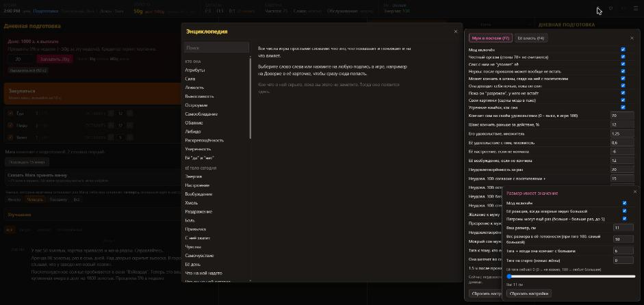
- **Убеждения с ясностью.** Не "разрешил / запретил", а три числа на акт: "думает, что хочешь", "думает, что не хочешь", "насколько ясно". Слова ("будь раскованнее") размазываются по многим актам с разным весом; "давай" по одному акту - точечно и ясно. Всё гаснет каждую ночь, если не повторять. Отдельно - твоё одобрение по каждому гостю.
- **"Вес слова"** - насколько твои желания и приказы для неё значат (иди сюда, иди помойся).
- **Самоощущение.** Характер каждую ночь ползёт к тому, кем она себя считает; у каждой героини свои скорости роста и падения.
- **Влечения** (лист -> характер): деньги, общение, гордость, безопасность, одобрение, желание, тоска - числами + вывод словами ("переживает из-за денег"). В карточке - строка "желания".
- **Память действий:** по каждому твоему действию хранится, сколько раз и как ей зашло; темы разговора приедаются.
- **Реакция на её поступок:** после того как она что-то сделала (разделась по приказу, вышла растрёпанной), появляется пункт "отреагировать" - три тона.
- **Она сама:** распускает лиф, предлагает танец, наливает себе, подсаживается к гостю, берёт понравившийся стол, целует тебя на ходу, зовёт посидеть, будит утром, идёт в баню, готовит, убирает, просит денег на рынок и на карты.
- **Скрытые черты открываются** по её поступкам и показываются чипами (за неделю две из трёх).
- **Откат** многошаговый, по действию. (Правки через консоль не откатывает, хотя справка обещает.)
- **Лог:** новое сверху, разделитель "с последнего действия", старое тускнеет, склейка повторов ("+4 ещё · 20:33-20:37", "×2"), "с прошлого действия ничего нового", значок у строк с картинкой, перемещения курсивом ("Mara -> ванная").
- **Настройки:** размер текста, 24 часа, "режим близости" (не показывать её, когда не в одной комнате), "держать панель статов открытой", запись лога игры в файл, автосейв в начале каждого дня (хранить N), опасная кнопка в два нажатия.
- **Старт:** кто она тебе (жена, возлюбленная, сводная сестра, подруга, работница), ползунки с вариантом "Судьба" (не выбрал - сюрприз), шесть способностей делят 300 очков, родня и где выросла, спойлер по галке.
- **Магия:** гримуар в задней комнате открывает ману и чары. Не разбирал.
- **Недоделки у них тоже есть:** непереведённые куски ("Call it a night", "her brother", "food, beer и wine"), повторы строк, внутренние имена в крошках (`_about_men_group:touching`).

---

## Механики, которых у нас нет совсем

По убыванию того, насколько они делают игру.

1. **Сводка "что изменилось за действие" с источниками** - делаю первым в части 2.
2. **Лестница с гостем мелкими шагами + его стадия + "смотрит на тебя" перед шагом.**
3. **Убеждения тройкой (хочет / не хочет / ясность) с источником и ночным откатом; одобрение по гостю как число.** У нас одно число на акт и позиция по гостю из трёх значений.
4. **Отказ по причине и согласие двумя голосами** - делаю в части 2.
5. **Карточка исхода** - делаю в части 2.
6. **Она просит денег** (на рынок, на карты) и вообще ситуации-просьбы от неё не про секс.
7. **Уведомление "она там-то с тем-то, дошло до..."**, когда ты не рядом.
8. **Признание-развилка** ("как ты хочешь, чтобы я с этим поступала").
9. **Граница при отправке** ("иди, но не дальше такого-то").
10. **Память "прошлой ночью"** в карточке и в мыслях на следующий день; "какой она кажется" утром.
11. **Влечения** (чего она хочет от жизни, не от тела).
12. **Самоощущение** как цель дрейфа характера.
13. **Склад по видам, готовка, порча, цены дня.**
14. **Уровень таверны как потолок репутации; содержание построек.**
15. **Баня как доход; торговцы с товаром.**
16. **Родня и друзья, которые заходят и при которых она другая.**
17. **Вылазки с риском** (охота, травы), раны мужа, усталость сверх энергии.
18. **Энциклопедия** и клик по числу.
19. **Калькулятор согласия "что если".**
20. **Настраиваемая раскладка колонок.**
21. **Зелья и магия.**
22. **Кто она тебе** (не только жена).

---

## Автопрогон дальше 7-го дня

См. раздел в конце файла (дописывается по мере прогона).
